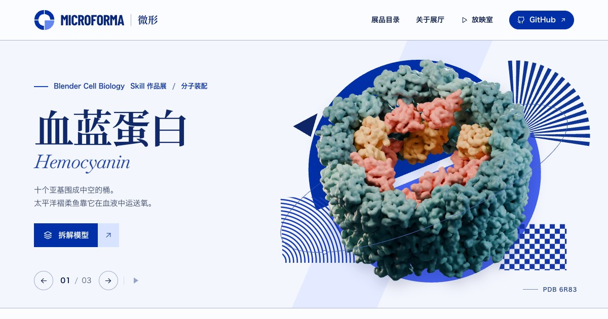

# 微形 Microforma

[打开互动展厅](https://rmgx-sanae.github.io/blender-cell-biology-gallery/)　[获取 Blender Cell Biology skill](https://github.com/RMgX-sanae/blender-cell-biology)

本仓库是 Blender Cell Biology skill 的作品展。六件展品包括两套可旋转和拆解的三维模型、两组结构图集和两段机制短片。网站使用本地字体和媒体，字体、图标及 Three.js 的许可证随静态资源提供。

[](https://rmgx-sanae.github.io/blender-cell-biology-gallery/)

## 本地观看

已安装 Node.js 和 pnpm 时，在本目录运行以下命令。预览服务支持影片的分段读取。

```sh
pnpm install --frozen-lockfile
pnpm preview
```

本地地址为 [http://127.0.0.1:8765/](http://127.0.0.1:8765/)。已构建的版本可直接托管在静态 HTTP 服务上。

GitHub Pages 从本仓库 main 分支的 `docs/` 目录发布。

## 编辑

`docs/index.html`、`docs/gallery.css` 和 `docs/gallery.js` 分别包含版面、视觉与展品目录。每件展品在详情中列出建模依据。三维查看器的可读源文件为 `viewer.js`。修改查看器后执行 `pnpm install --frozen-lockfile` 和 `pnpm build`。

血蓝蛋白沿用 6R83 的十个来源亚基，保持每个亚基内部的八个功能单元。超净工作台按七个器械部件组拆解。网页中的位移用于分辨各组。两组图集展示红藻藻胆体与衣藻轴丝。短片分别为 32 秒的 V 型质子泵循环和 Arp2/3 教学影片中 25 秒的分支成核章节。

三维视图支持鼠标拖动、触屏双指缩放和键盘方向键。加减键控制缩放，Home 复位。首页切换展品按钮旁可以暂停几何动效，系统的减少动态效果偏好也会生效。
